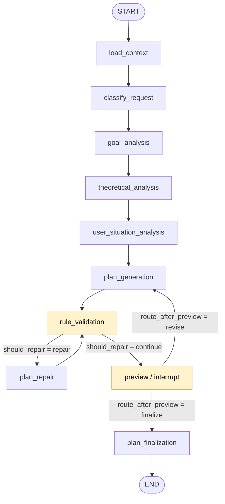
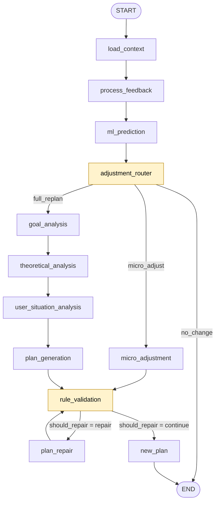

# LangGraph 状态机完整文档

> 本文是当前代码的**权威 LangGraph 说明**。`docs/langgraph.md` 与
> `docs/agent/state-machine.md` 已部分过时；冲突时以本文为准。
>
> 版本：`GRAPH_A_VERSION = initial-plan-v1`、`GRAPH_B_VERSION = feedback-loop-v1`
> （`app/agent/graph.py:62-63`）。两张图都用
> `StateGraph(PlannerState, context_schema=PlannerContext)`（`graph.py:110/149`）。

---

## 0. 先看这张“文件 → 职责”表

| 文件 | 负责什么 |
| --- | --- |
| `app/agent/graph.py` | **构图**：`add_node` / `add_edge` / `add_conditional_edges` / `compile`；`PlannerGraph` 门面 |
| `app/agent/nodes/*.py` | **节点实现**：每个节点函数、它读写哪些 state、发什么事件 |
| `app/agent/router.py` | **条件边**：`should_repair`、`route_after_preview`、`route_after_adjustment`；以及 `AdjustmentRouter` 路由策略 |
| `app/agent/state.py` | `PlannerState`、`PlannerContext`、`PlannerRequest`、`GoalInput`、`AgentConfig` |
| `app/agent/context.py` | `PlanningContext` / `CurrentPlanSnapshot`（应用层注入的只读上下文） |
| `app/agent/tools/__init__.py` | 工具注册 |
| `app/agent/prompts/*.md` | 各节点 prompt 模板 |
| `app/application/services/plan_service.py` | 调用门面、持久化、事件 sink、事务 |

---

## 1. Graph A：初始计划 / 预览确认

构图：`build_initial_plan_graph`，`app/agent/graph.py:106-139`。

### 1.1 节点

| 节点名 | 注册行 | 节点函数 | 文件:行 | 职责 | 主要输出 state | 事件 | 工具 | Prompt |
| --- | --- | --- | --- | --- | --- | --- | --- | --- |
| `load_context` | `graph.py:111` | `load_context_node` | `nodes/context.py:18` | 唯一 DB→Agent 入口：用户上下文/当前计划/进度/画像 | `user_context`、`current_plan`、`progress`、`profile_prompt`、`profile_replan` | `node.started/completed` | — | — |
| `classify_request` | `graph.py:112` | `classify_request_node` | `nodes/classify.py:17` | 确定性意图分类；**结果当前不参与分支** | `classify` | `node.started/completed` | — | — |
| `goal_analysis` | `graph.py:113` | `goal_analysis_node` | `nodes/goal_analysis.py:14` | 目标 → objective/subtasks/constraints | `goal_analysis` | `node.*`、`tool.completed` | `task_decomposer` | `goal_analysis.md` |
| `theoretical_analysis` | `graph.py:114` | `theoretical_analysis_node` | `nodes/theoretical_analysis.py:17` | 理论工作量（video/reading/practice、difficulty、认知负荷） | `theoretical_analysis` | 同上 | `workload_estimator` | `theoretical_analysis.md` |
| `user_situation_analysis` | `graph.py:115` | `user_situation_analysis_node` | `nodes/user_situation.py:51` | 调 ML 预测时长/完成率/压力/时段；LLM 只补 narrative | `user_situation`、`prediction_source` | 同上 | `task_duration_predictor`、`memory_retriever` | `user_situation.md` |
| `plan_generation` | `graph.py:116` | `plan_generation_node` | `nodes/plan_generation.py:49` | 生成任务草稿（INITIAL / ADJUSTMENT / REPLAN 三模式） | `plan_draft`、`repair_attempts=0` | 同上 | `plan_drafter`、`memory_retriever` | `initial_plan.md` / `adjustment.md` / `replanning.md` |
| `rule_validation` | `graph.py:117` | `rule_validation_node` | `nodes/validation.py:20` | Scheduler 排期 + RuleEngine 硬约束；唯一产出 `candidate_plan` | `candidate_plan`、`rule_violations`、`rule_validation` | 同上 | `schedule_generator`、`rule_validator` | — |
| `plan_repair` | `graph.py:118` | `plan_repair_node` | `nodes/repair.py:44` | 有界确定性修复（丢弃/前移最低优先级任务） | `plan_draft`、`repaired_plan`、`candidate_plan`、`repair_attempts` | 同上 | `schedule_generator`、`rule_validator` + 直接 scheduler/rule_engine | — |
| `preview` | `graph.py:119` | `preview_node` | `nodes/preview.py:74` | 组装预览并 `interrupt()` 暂停；执行调整预算 | `preview`、`user_adjustment`、`adjustment_count` | `waiting_user_confirmation`、`preview.generated`、`node.*` | — | — |
| `plan_finalization` | `graph.py:120` | `plan_finalization_node` | `nodes/finalization.py:27` | 冻结成 `FinalPlanPayload` | `final_plan`、`confidence` | `plan.generated`、`node.*` | — | — |

### 1.2 边

| from → to | 类型 | 行号 | 说明 |
| --- | --- | --- | --- |
| `START → load_context` | 普通 | `graph.py:122` | |
| `load_context → classify_request` | 普通 | `:123` | |
| `classify_request → goal_analysis` | 普通（**无条件**） | `:124` | `classify` 结果无人读取 |
| `goal_analysis → theoretical_analysis` | 普通 | `:125` | |
| `theoretical_analysis → user_situation_analysis` | 普通 | `:126` | |
| `user_situation_analysis → plan_generation` | 普通 | `:127` | |
| `plan_generation → rule_validation` | 普通 | `:128` | |
| `rule_validation → plan_repair / preview` | 条件 | `:129-131` | `should_repair` |
| `plan_repair → rule_validation` | 普通（回环） | `:132` | |
| `preview → plan_generation / plan_finalization` | 条件 | `:133-137` | `route_after_preview` |
| `plan_finalization → END` | 普通 | `:138` | |

---

## 2. Graph B：反馈闭环

构图：`build_feedback_loop_graph`，`app/agent/graph.py:145-187`。

### 2.1 节点

| 节点名 | 注册行 | 节点函数 | 文件:行 | 职责 |
| --- | --- | --- | --- | --- |
| `load_context` | `graph.py:150` | `load_context_node` | `nodes/context.py:18` | 同 Graph A |
| `process_feedback` | `graph.py:151` | `process_feedback_node` | `nodes/feedback.py:15` | 解读已落库反馈，写 `replan_reason` / notes |
| `ml_prediction` | `graph.py:152` | `ml_prediction_node` | `nodes/prediction.py:84` | 组装 `AdjustmentRequest`，调 adjustment predictor |
| `adjustment_router` | `graph.py:153` | `adjustment_router_node` | `nodes/adjustment_router.py:16` | 跑 `AdjustmentRouter.decide`，写 `route` |
| `micro_adjustment` | `graph.py:154` | `micro_adjustment_node` | `nodes/micro_adjustment.py:45` | 轻量调整：复用未完成任务、缩放限额；**不调 LLM** |
| `goal_analysis` | `graph.py:155` | `goal_analysis_node` | `nodes/goal_analysis.py:14` | FULL_REPLAN 重跑分析链 |
| `theoretical_analysis` | `graph.py:156` | `theoretical_analysis_node` | `nodes/theoretical_analysis.py:17` | 同上 |
| `user_situation_analysis` | `graph.py:157` | `user_situation_analysis_node` | `nodes/user_situation.py:51` | 同上 |
| `plan_generation` | `graph.py:158` | `plan_generation_node` | `nodes/plan_generation.py:49` | 同上 |
| `rule_validation` | `graph.py:159` | `rule_validation_node` | `nodes/validation.py:20` | 同上 |
| `plan_repair` | `graph.py:160` | `plan_repair_node` | `nodes/repair.py:44` | 同上 |
| `new_plan` | `graph.py:161` | `new_plan_node` | `nodes/replan.py:16` | 复用 `plan_finalization_node` 产出新版本 |

### 2.2 边

| from → to | 类型 | 行号 | 说明 |
| --- | --- | --- | --- |
| `START → load_context` | 普通 | `:163` | |
| `load_context → process_feedback` | 普通 | `:164` | |
| `process_feedback → ml_prediction` | 普通 | `:165` | |
| `ml_prediction → adjustment_router` | 普通 | `:166` | |
| `adjustment_router → END / micro_adjustment / goal_analysis` | 条件 | `:167-175` | `route_after_adjustment` |
| `micro_adjustment → rule_validation` | 普通 | `:176` | |
| `goal_analysis → theoretical_analysis` | 普通 | `:178` | FULL_REPLAN 链 |
| `theoretical_analysis → user_situation_analysis` | 普通 | `:179` | |
| `user_situation_analysis → plan_generation` | 普通 | `:180` | |
| `plan_generation → rule_validation` | 普通 | `:181` | |
| `rule_validation → plan_repair / new_plan` | 条件 | `:182-184` | `should_repair` |
| `plan_repair → rule_validation` | 普通（回环） | `:185` | |
| `new_plan → END` | 普通 | `:186` | |

---

## 3. 条件函数（精确逻辑）

### 3.1 `should_repair` — `app/agent/router.py:153-160`

```python
violations = state.get("rule_violations") or []
attempts = int(state.get("repair_attempts") or 0)
max_attempts = int(state.get("max_repair_attempts") or 2)
return "repair" if (violations and attempts < max_attempts) else "continue"
```

- 只看“有没有 violation”，不自己判断 hard；`rule_validation_node` 只写入硬违规。
- Graph A：`repair → plan_repair`，`continue → preview`。
- Graph B：`repair → plan_repair`，`continue → new_plan`。

### 3.2 `route_after_preview` — `app/agent/router.py:163-167`

```python
return "revise" if state.get("user_adjustment") else "finalize"
```

- `revise → plan_generation`；`finalize → plan_finalization`。
- 预算耗尽时 `preview_node` 把 `user_adjustment` 置 `None`，所以会 finalize。

### 3.3 `route_after_adjustment` — `app/agent/router.py:143-150`

```python
route = state.get("route") or AdjustmentRoute.NO_CHANGE
return {
    AdjustmentRoute.NO_CHANGE: "no_change",
    AdjustmentRoute.MICRO_ADJUST: "micro_adjust",
    AdjustmentRoute.FULL_REPLAN: "full_replan",
}[route]
```

- `no_change → END`；`micro_adjust → micro_adjustment`；`full_replan → goal_analysis`。

### 3.4 `AdjustmentRouter.decide` — `app/agent/router.py:52-88`

基础预测来自 `ml_prediction`；然后 `_override`（`:106-137`）按顺序覆盖，最后画像升级（`:72-87`，只升不降）：

| 优先级 | 条件 | 结果 |
| --- | --- | --- |
| 1 | 没有当前计划 | `FULL_REPLAN` |
| 2 | `user_adjustment` 非空（当前实现：自由文本/手动备注） | `FULL_REPLAN` |
| 3 | `progress.days_elapsed >= 2` 且 `progress.completion_rate < 0.3` | `FULL_REPLAN` |
| 4 | `adjustment_count >= 2` | `FULL_REPLAN`（反馈图里恒 0，实际不触发） |
| 5 | `profile_replan == "full_replan"` | 升级为 `FULL_REPLAN` |
| 6 | `profile_replan == "local_repair"` 且当前 `NO_CHANGE` | 升级为 `MICRO_ADJUST` |

> **注意**：第 2、3 条是当前“完成率/备注直接触发重排”的来源。重构反馈策略时
> 应切断它们，改为“压力/精力 + 画像证据”；手动重排应通过显式
> `trigger_type == REPLAN_REQUEST` 强制 FULL（详见 `docs/replan-trigger-design.md`）。

---

## 4. Mermaid 图

### 4.1 Graph A



### 4.2 Graph B



---

## 5. `PlannerState` 关键键（谁写/谁读）

完整定义：`app/agent/state.py:196-252`。

| 键 | 主要写入 | 主要读取 |
| --- | --- | --- |
| `request` | `graph._seed_state` | 各节点 |
| `goals` | `_seed_state` / `load_context` | goal/theoretical/user_situation/plan_generation |
| `user_context` | `load_context` | 各节点（含 ML/画像） |
| `current_plan` | `load_context` | router / micro_adjustment / plan_generation |
| `goal_id_map` | `_seed_state` | validation / repair / persist |
| `classify` | `classify_request` | **无人读取** |
| `goal_analysis` | `goal_analysis` | theoretical_analysis |
| `theoretical_analysis` | `theoretical_analysis` | user_situation / plan_generation |
| `user_situation` | `user_situation` | plan_generation |
| `ml_prediction` | `ml_prediction` | router / micro_adjustment / plan_generation |
| `plan_draft` | plan_generation / repair / micro_adjustment | validation / repair / preview / finalization |
| `candidate_plan` | validation / repair | preview / persist |
| `rule_violations` | validation / repair | `should_repair` |
| `repaired_plan` | repair | **无人读取** |
| `preview` | preview | plan_generation |
| `user_adjustment` | preview / feedback | router / plan_generation |
| `adjustment_count` | preview | preview / finalization / router |
| `route` | adjustment_router | router / finalization |
| `profile_prompt` | load_context | plan_generation |
| `profile_replan` | load_context | router |
| `limit_factor` | micro_adjustment | `resolve_preferences` |
| `replan_reason` | feedback / micro_adjustment | plan_generation / finalization |
| `final_plan` | finalization | service persistence |
| `progress` | load_context | router / user_situation / plan_generation |
| `notes` / `errors` / `tool_results` | 各节点 | reducer 累加；notes 进预览；errors 转 warnings |

> 只写不读的键：`classify`、`adjustment_rejected`、`repaired_plan`、
> `confidence`、`tool_results`（审计走 `tool.completed` 事件）。

---

## 6. `PlannerContext` / `PlannerRequest`

### 6.1 `PlannerContext`（`app/agent/state.py:72-107`）

运行期依赖，通过 LangGraph `context_schema` 注入，**不进 checkpoint**：

| 字段 | 用途 |
| --- | --- |
| `scheduler` | `rule_validation` / `plan_repair` 直接排期 |
| `rule_engine` | `plan_repair` 直接判硬约束 |
| `predictors` | `ml_prediction`、`task_duration_predictor` |
| `config` | 修复/预览/路由预算 |
| `llm` | `StructuredLLM`；`None` 走确定性 fallback |
| `context_builder` | `load_context` 唯一的 DB 入口 |
| `tools` | 懒加载 `ToolRegistry` |
| `emit` | 事件 sink（`publish` 永不抛） |

### 6.2 `PlannerRequest`（`app/agent/state.py:148-168`）

`user_id`、`trigger_type`、`goals`、`plan_id`、`user_note`、`plan_title`、
`start_date`、`end_date`、`preferences`、`mbti`、`execution_weight`、`profile`。

> `trigger_type` 目前在很多链路没有被正确设置；重构反馈策略时建议：
> 反馈图 → `FEEDBACK_DRIVEN`，手动重排 → `REPLAN_REQUEST`。

---

## 7. 门面与 Service 调用关系

`PlannerGraph`（`app/agent/graph.py:211-389`）：

| 方法 | 行 | 作用 |
| --- | --- | --- |
| `generate_preview` | 300 | 跑 Graph A 到 preview 暂停 |
| `resume_preview` | 324 | confirm/adjust 恢复 Graph A |
| `process_feedback` | 348 | 跑 Graph B |
| `replan` | 366 | 显式重排（Graph B） |
| `pending_state` | 289 | 查暂停中的状态 |

Service（`app/application/services/plan_service.py`）：

| 方法 | 行 | 调用 |
| --- | --- | --- |
| `generate_preview` | 280 | `graph.generate_preview` |
| `confirm_plan` | 316 | `graph.resume_preview(action="confirm")` |
| `adjust_preview` | 357 | `graph.resume_preview(action="adjust")` |
| `generate_plan_with_events` | 420 | `generate_preview` + `confirm_plan` |
| `process_feedback_cycle` | 444 | `graph.process_feedback` |
| `replan_with_agent` | 509 | `graph.replan` |
| `pending_draft` | 635 | `graph.pending_state` |

---

## 8. 事件 / SSE 映射（有例外，别想当然）

节点用 `ctx.publish(name, payload)`（`state.py:100-107`）。`PlanService._run`
把事件镜像给 `emit`（`plan_service.py:237-240`）；`GenerationService._run_job`
转成 `AgentEvent`；`_frame`（`generation_service.py:238-242`）决定 SSE `event:`：

- `node.completed` 且带 `node` → `event: <节点名>`。
- 否则 → `event: <stage or event>`。

因此：

| 原始事件 | SSE `event:` |
| --- | --- |
| `node.started` / `node.completed` | 节点名 |
| `ml.started`（带 `node=ml_prediction`） | `ml_prediction` |
| `ml.completed`（不带 node） | `ml.completed` |
| `preview.generated` | `preview`（`data.event=preview.generated`） |
| `plan.generated` | `plan_finalization`（`data.event=plan.generated`） |
| `tool.completed` | `tool.completed` |
| `waiting_user_confirmation` | 原名 |
| `agent.started/completed`、`replanning.started/completed` | 原名 |
| 终态 | `completed` / `failed` |

**`new_plan` 不会作为 SSE event 出现**：它内部复用
`plan_finalization_node`，事件名是 `plan_finalization`。
`ml_prediction` 也不会出现在 `agent_runs.nodes_executed`，因为它没有
`node.started/completed`。

---

## 9. 工具（注册 7 个）

注册：`app/agent/tools/__init__.py:25-44`；懒加载：`PlannerContext.tool`（`state.py:87-98`）。

| 工具 | 类/文件 | LLM 暴露 | 调用节点 |
| --- | --- | --- | --- |
| `task_decomposer` | `tools/task_decomposer.py:39` | 是 | `goal_analysis` |
| `workload_estimator` | `tools/workload_estimator.py:67` | 是 | `theoretical_analysis` |
| `plan_drafter` | `tools/plan_drafter.py:75` | 是 | `plan_generation` |
| `schedule_generator` | `tools/schedule_generator.py:27` | 否 | `rule_validation` / `plan_repair` |
| `rule_validator` | `tools/rule_validator.py:24` | 否 | `rule_validation` / `plan_repair` |
| `memory_retriever` | `tools/memory_retriever.py:47` | 否 | `plan_generation` / `user_situation` |
| `task_duration_predictor` | `tools/task_duration_predictor.py:37` | 否 | `user_situation_analysis` |

`adjustment_predictor` 和 `micro_adjustment` 不是注册工具，只在
`ToolCallRecord` 里留审计记录。

---

## 10. 已知坑 / 文档与代码不一致

1. **`classify_request` 是语义孤儿**：写 `classify`，无人读；`classify_request → goal_analysis` 无条件。
2. **`new_plan` 不发自己的事件**：SSE/审计里看到的是 `plan_finalization`。
3. **`ml_prediction` 命名折叠**：`ml.started` 因带 node 被改名为 `ml_prediction`；`ml.completed` 保留原名。
4. **`adjustment_count` 在 Graph B 恒为 0**：`_seed_state` 置 0，micro 不递增，所以 router 第 4 条在反馈图里不触发。
5. **FULL_REPLAN 带备注时走 ADJUSTMENT 而不是 REPLAN 模式**：`process_feedback` 同时写 `replan_reason` 和 `user_adjustment`；`plan_generation._mode` 先判 `user_adjustment`。这会让 `plan_drafter._fallback` 的 ADJUSTMENT 分支失效（Graph B 没有 preview）。
6. **Graph B FULL_REPLAN 不注入 `goal_id_map`**：反馈生成的新版本可能把 `goal_id` 写成 1..n，而不是真实 Goal 主键。
7. **手动 `replan()` 只清空 `route`**，并不强制 FULL；真正强制来自 `process_feedback` 写入 `user_adjustment`。若改成“备注不再强制 FULL”，必须显式用 `trigger_type` 保证手动重排仍然 FULL。
8. **`AgentConfig.max_preview_adjustments` 默认 2，Settings 默认 3**：生产实际是 3；文档写 2 是过时的。
9. **`failure_min_days_elapsed` 不可配置**：写死在 `router.py:46`。
10. **SSE 文档把 `preview.generated` 当 event 名**：实际是 `preview`；`data.event` 才是 `preview.generated`。

---

## 11. 想改图/节点时看哪里

| 目的 | 位置 |
| --- | --- |
| 改 Graph A 拓扑 | `app/agent/graph.py:106-139` |
| 改 Graph B 拓扑 | `app/agent/graph.py:145-187` |
| 改节点实现 | `app/agent/nodes/<node>.py` |
| 改节点名/SSE stage | 各节点文件的 `NODE = "..."` |
| 改条件边 | `app/agent/router.py:143-167` |
| 改路由策略 | `app/agent/router.py:52-137` |
| 改状态字段 | `app/agent/state.py:196-252` |
| 改运行期依赖 | `app/agent/state.py:72-107` |
| 改工具注册 | `app/agent/tools/__init__.py:25-44` |
| 改 prompt | `app/agent/prompts/*.md` |
| 改事件/SSE | `app/application/services/generation_service.py:238-260`、`app/api/v1/plans.py:436-458` |

---

## 12. 建议的后续修正（与状态机相关）

- 让 `trigger_type` 真正贯穿：反馈 → `FEEDBACK_DRIVEN`，手动 → `REPLAN_REQUEST`。
- 切断“自由文本 → FULL_REPLAN”，把备注变成上下文/`replan_reason`。
- 切断“完成率单独 → FULL_REPLAN”，改用压力/精力 + 画像证据。
- 给 Graph B FULL_REPLAN 注入 `goal_id_map`，避免 goal_id 错位。
- 给 `new_plan` / `ml_prediction` 补 `node.started/completed`，或更新文档明确例外。
- 统一 `max_preview_adjustments` 的默认值（AgentConfig vs Settings）。
